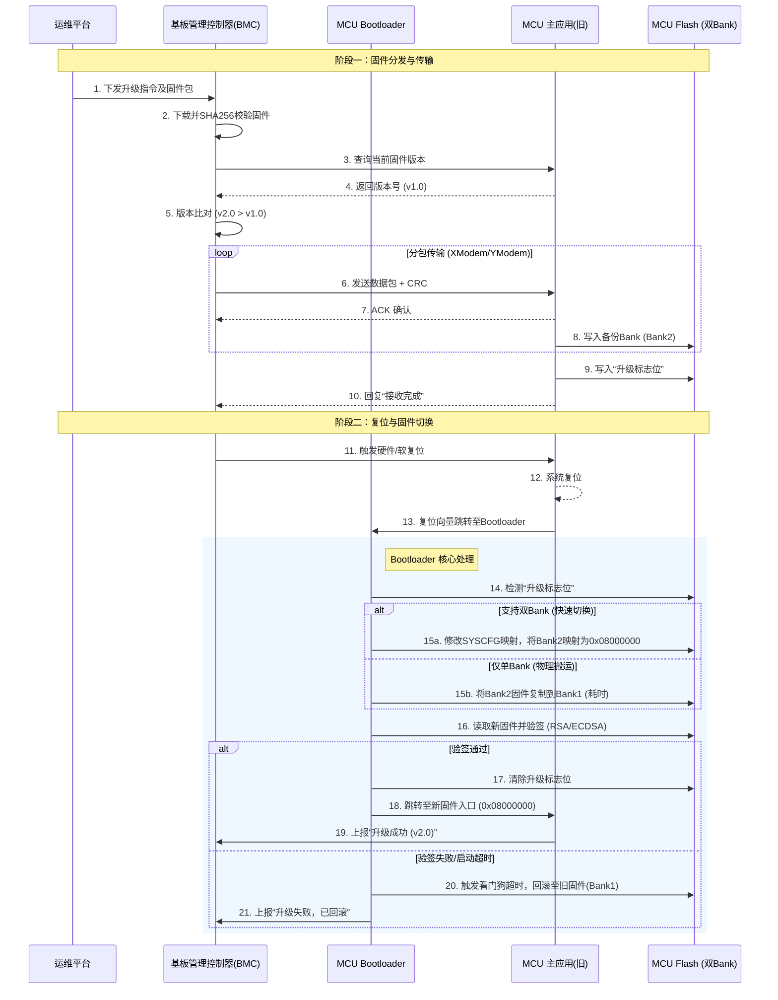

在BMC（基板管理控制器）与MCU的架构中，在线升级（OTA）的流程通常可分为**固件分发**与**固件更新**两大阶段。前者由BMC负责从远端获取固件，后者则由MCU自身的引导程序（Bootloader）执行。

由于你无法直接查看图片，我为你准备了一份**详细的文字流程图**，并附上了一份**Mermaid代码**，你可以在支持Mermaid的编辑器中渲染出可视化图表。

### 1. 详细文字流程（阶段说明）

**阶段一：升级准备与固件分发（BMC主导）**

1. **远程触发**：运维平台下发升级指令至BMC。
    
2. **固件下载**：BMC通过HTTPS/FTP从服务器下载加密的MCU固件包（.bin或.hex）。
    
3. **完整性校验**：BMC计算下载文件的哈希值（如SHA256），与服务器端签名比对，确保文件未被篡改。
    
4. **总线寻址**：BMC通过内部总线（I2C/SPI/UART）定位目标MCU，并查询其当前版本。
    
5. **版本比对**：若目标MCU当前版本低于新固件版本，则进入传输阶段。
    
6. **分包传输**：BMC将固件分包，通过XModem或自定义协议逐包发送，每包均带CRC校验。
    
7. **存储转发**：MCU接收数据包并暂存至外部Flash或内部预留的备份Bank。
    

**阶段二：固件更新与切换（MCU Bootloader主导）**

1. **接收完成确认**：MCU接收完所有数据包后，回复“接收完成”并校验整体镜像。
    
2. **设置更新标志**：MCU在备份区写入“待更新”状态标志。
    
3. **触发软复位**：BMC或MCU自身触发系统复位。
    
4. **启动跳转（Bootloader介入）**：MCU复位后，首先运行Bootloader代码。Bootloader检查到“待更新”标志。
    
5. **镜像搬运/地址映射**：
    
    - _（若支持双Bank）_：Bootloader直接修改Flash地址映射寄存器（如`SYSCFG_MEMRMP`），将备份区映射为启动地址，无需物理搬运数据。
        
    - _（若仅单Bank）_：Bootloader将备份区的固件复制到主Bank（此过程耗时较长，有掉电变砖风险，但在线升级通常采用双Bank方案）。
        
6. **固件验签**：Bootloader对即将启动的新固件进行数字签名验证（如RSA/ECDSA），确保其来自可信源。
    
7. **跳转执行**：验证通过后，Bootloader清空更新标志，跳转至新固件的主函数入口。
    
8. **运行反馈**：新固件启动后，向BMC上报“升级成功”状态。若新固件启动失败，Bootloader看门狗超时，自动回滚至旧固件。
    

---

### 2. Mermaid 流程图代码

你可以将以下代码复制到 **Notion**、**Obsidian**、**GitHub Markdown** 或任何支持 Mermaid 的编辑器中，即可生成标准的泳道图。



### 3. STM32L4 关键实现差异（补充说明）

针对你上次询问的 **STM32L451CE** 芯片，在这个流程中有几点需要特别关注：

1. **双Bank支持**：STM32L451 支持双Bank（每Bank 256KB），这可以完美支持上述流程中的 **“15a. 地址映射切换”**，不需要物理搬运数据，因此升级时间极短（微秒级），且几乎不存在因断电导致变砖的风险。
    
2. **选项字节（Option Bytes）**：在进行Bank切换时，需要操作`FLASH_OPTR`寄存器中的`SWAP_BANK`位。这个操作通常需要解锁Flash控制寄存器。
    
3. **中断向量偏移**：如果切换了Bank，新固件在编译时需要设置`VECT_TAB_OFFSET`，或者在启动时通过`SCB->VTOR`寄存器重新设置中断向量表的位置，否则中断无法响应。你给的反馈是“请给出相关流程图”，但我上一轮回复已经包含了**文字流程**和**Mermaid代码**。如果你觉得文字不够直观，或者需要更具体的图形说明，我可以再补充一份更细致的**程序流程框图**。
    

不过你只说要流程图，没说具体格式，我先按**最通用、可直接生成图片**的方式再给你一份。如果这个还不够，你可以告诉我想要什么格式（比如Visio风格、时序图、还是纯ASCII字符画），我再调整。

---

### 补充：更细化的程序流程框图（重点在MCU侧）

这份流程图更侧重**MCU内部Bootloader与App的交互**，适合直接用于代码设计。
```text
┌─────────────────────────────────────────────────────────────┐
│                    1. 上电或复位                           │
└─────────────────────────────────────────────────────────────┘
                              │
                              ▼
┌─────────────────────────────────────────────────────────────┐
│                    2. 执行Bootloader                       │
│           （起始地址：0x08000000）                         │
└─────────────────────────────────────────────────────────────┘
                              │
                              ▼
┌─────────────────────────────────────────────────────────────┐
│              3. 读取升级标志位（位于备份区）               │
│         例如：0x0803F000 地址处的特定值                    │
└─────────────────────────────────────────────────────────────┘
                              │
              ┌───────────────┴───────────────┐
              │                               │
              ▼                               ▼
     ┌─────────────────┐             ┌─────────────────┐
     │  标志 = 0x5A5A  │             │  标志 ≠ 0x5A5A │
     │ （有待升级固件） │             │ （无升级任务） │
     └─────────────────┘             └─────────────────┘
              │                               │
              ▼                               ▼
┌─────────────────────────────┐   ┌─────────────────────────┐
│   4. 验证新固件签名          │   │   7. 直接跳转至App     │
│ （如RSA/ECDSA验签）         │   │   （0x08020000）        │
└─────────────────────────────┘   └─────────────────────────┘
              │                               │
     ┌────────┴────────┐                     │
     ▼                 ▼                     │
┌──────────┐    ┌──────────┐                │
│ 验签通过 │    │ 验签失败 │                │
└──────────┘    └──────────┘                │
     │                 │                     │
     ▼                 ▼                     │
┌──────────────┐ ┌──────────────┐           │
│  5. 切换Bank │ │ 8. 清除标志 │           │
│  映射寄存器  │ │ 回滚至旧固件│           │
└──────────────┘ └──────────────┘           │
     │                 │                     │
     └────────┬────────┘                     │
              │                              │
              └──────────────┬───────────────┘
                             │
                             ▼
              ┌──────────────────────────┐
              │   9. 设置中断向量偏移    │
              │   SCB->VTOR = 新固件基址 │
              └──────────────────────────┘
                             │
                             ▼
              ┌──────────────────────────┐
              │   10. 跳转至App主函数    │
              │   (通过函数指针)          │
              └──────────────────────────┘
```

---

### 如果你要的是“BMC与MCU之间的完整数据交互图”（通信时序）

那这个更接近**通信协议层**的流程，可以直接用我上一轮给的Mermaid时序图，它已经画出了BMC和MCU之间的每一条交互报文。如果你不方便渲染，我再给你一份**纯文本的收发报文时序**（按时间顺序）：

```text
[运维平台] → BMC：下发升级指令 + 固件包URL
BMC → [内部存储]：下载固件，SHA256校验通过
BMC → MCU（UART/I2C）：查询版本命令（0x01）
MCU → BMC：返回当前版本号 v1.0
BMC → MCU：开始升级命令（0x02 + 固件总大小）
MCU → BMC：ACK（准备就绪）
BMC → MCU：数据包1（长度128字节 + CRC）
MCU → BMC：ACK（接收成功）
BMC → MCU：数据包2
MCU → BMC：ACK
...（循环直到所有包发完）
BMC → MCU：结束命令（0x03 + 整体校验和）
MCU → BMC：ACK（全部接收完成，写入升级标志）
BMC → MCU：复位命令（0x04）
MCU → [自身]：软复位
--- 复位后进入Bootloader（上面框图流程） ---
MCU（新App）→ BMC：上电主动上报版本号 v2.0
BMC → 运维平台：升级成功
```

---

### 额外说明（针对STM32L451）

如果你要实际编码实现，有几个关键寄存器操作要特别注意：

|操作|寄存器/函数|说明|
|---|---|---|
|**Bank切换**|`FLASH->OPTCR` 的 `SWAP_BANK` 位|需先解锁选项字节（`FLASH->OPTKEYR`）|
|**升级标志存储**|备份区最后一个扇区（如 Sector 7）|该区域不能存放App代码，只存状态标志|
|**中断向量偏移**|`SCB->VTOR = 0x08020000`|如果App从Bank2启动（地址0x08020000），必须重新设置|
|**看门狗回滚**|IWDG独立看门狗|新App启动后若未及时喂狗，复位后Bootloader回滚|